# Operating Systems Networking Suite: Multi-User Group Chat, Concurrent FTP & Enterprise CTM CLI

A modular, enterprise-grade Linux system programming suite implemented in C. Developed specifically for an **Operating Systems** curriculum, this codebase demonstrates core operating systems principles including **Client-Server Architecture with Multi-User Group Chat (GC)**, **Browser-Based Employee Authentication (Single Sign-On)**, **POSIX Multithreading (`pthreads`) & Mutex Synchronization (`pthread_mutex_t`)**, **Multiprocessing Concurrency (`fork`)**, **Inter-Process Communication (`AF_UNIX` sockets)**, **Kernel Advisory File Locking (`flock`)**, and **Background Daemonization**.

---

## Table of Contents

- [Architectural Overview](#architectural-overview)
  - [1. Client-Server Corporate Group Chat (GC) with Browser SSO](#1-client-server-corporate-group-chat-gc-with-browser-sso)
  - [2. Concurrent Multi-Process FTP Server](#2-concurrent-multi-process-ftp-server)
  - [3. Asynchronous Multi-Peer P2P Suite (CTM)](#3-asynchronous-multi-peer-p2p-suite-ctm)
- [Browser-Based Employee Authentication Portal](#browser-based-employee-authentication-portal)
- [File Storage Architecture Guide](#file-storage-architecture-guide)
- [Operating Systems Concepts Implemented](#operating-systems-concepts-implemented)
- [Project Directory Structure](#project-directory-structure)
- [Build Instructions](#build-instructions)
- [Execution & Usage Guide](#execution--usage-guide)
  - [1. Running the Corporate Group Chat (GC)](#1-running-the-corporate-group-chat-gc)
  - [2. Running the Concurrent FTP System](#2-running-the-concurrent-ftp-system)
  - [3. Running the CTM Multi-Peer Asynchronous Suite](#3-running-the-ctm-multi-peer-asynchronous-suite)
- [Protocol Specifications](#protocol-specifications)
- [Documentation & Reports](#documentation--reports)

---

## Architectural Overview

This project includes three complementary networking subsystems, contrasting **Centralized Multi-User Client-Server coordination** with **Concurrent multi-process file distribution** and **Asynchronous daemonized multi-peer communication**:

```mermaid
flowchart TD
    subgraph Browser_Auth["Browser-Based Employee Authentication Portal (SSO)"]
        direction TB
        CC["Client Startup (chat_client / ctm)"] -->|"1. Spawns HTTP Loopback"| AS["Auth Server (127.0.0.1:8585)"]
        AS -->|"2. fork() + exec(xdg-open)"| BR["Default Web Browser"]
        BR -->|"3. HTTP POST: employee_id + password"| AS
        AS -->|"4. Validates vs storage/employees.txt"| DB[("Employee Credential Registry")]
        AS -->|"5. HTTP 200 OK + Verified Badge"| BR
        AS -->|"6. Authenticated Session Badge"| CC
    end

    subgraph Corporate_Group_Chat["1. Client-Server Architecture (Corporate Group Chat Room)"]
        direction TB
        C1["Client 1: Alice (EMP001)"] <-->|"TCP Socket (8080)"| SVR["Central Chat Server (chat_server)"]
        C2["Client 2: Bob (EMP002)"] <-->|"TCP Socket (8080)"| SVR
        C3["Client 3: Charlie (EMP003)"] <-->|"TCP Socket (8080)"| SVR
        CN["Client N: Rey (EMP101)..."] <-->|"TCP Socket (8080)"| SVR
        
        subgraph Server_Internals["Thread-Safe Group Chat Engine (chat_room_t)"]
            MUTEX["pthread_mutex_t room_lock"]
            POOL["Connection Pool: up to 32 concurrent employees"]
            BCAST["Real-time Non-blocking Broadcast Fan-Out"]
            MUTEX --- POOL --- BCAST
        end
        SVR --- Server_Internals
    end

    subgraph Concurrent_FTP["2. Client-Server File Architecture (Concurrent FTP)"]
        direction TB
        FC1["FTP Client 1"] -->|"TCP Request (Port 9000)"| MFS["Master FTP Server (ftp_server)"]
        FC2["FTP Client 2"] -->|"TCP Request (Port 9000)"| MFS
        MFS -->|"fork() Child 1"| W1["Child Worker Process 1"]
        MFS -->|"fork() Child 2"| W2["Child Worker Process 2"]
        W1 -->|"Streams from storage/ | Reads"| FC1
        W2 -->|"Streams from storage/ | Reads"| FC2
        FC1 -.->|"Writes byte stream"| D1["downloads/ (Client Storage)"]
        FC2 -.->|"Writes byte stream"| D2["downloads/ (Client Storage)"]
    end

    subgraph CTM_Multi_Peer["3. Decentralized Multi-Peer P2P Suite (CTM)"]
        direction TB
        CLI1["Alice CLI (ctm text Bob / Charlie)"] <-->|"AF_UNIX"| DA["Alice Daemon (:8088)"]
        CLI2["Bob CLI (ctm whoami / log)"] <-->|"AF_UNIX"| DB_D["Bob Daemon (:8089)"]
        CLI3["Charlie CLI"] <-->|"AF_UNIX"| DC["Charlie Daemon (:8090)"]
        DA <-->|"Dynamic Peer Port Routing"| DB_D
        DA <-->|"Dynamic Peer Port Routing"| DC
        DB_D <-->|"Dynamic Peer Port Routing"| DC
    end
```



---

### 1. Client-Server Corporate Group Chat (GC) with Browser SSO
*Implemented in: `src/server/` (`relay.c`, `server_main.c`), `src/client/` (`chat_client.c`, `client_main.c`), and `src/common/` (`auth.c`)*

The Chat Messenger implements an enterprise **Multi-User Group Chat (GC)** architecture:
- **Mandatory Browser Authentication Gate**: With each login session, `chat_client` initiates a local HTTP loopback server and auto-redirects the employee's default browser to a login portal. The employee confirms their `employee_id` and corporate `password`. Non-employees or wrong passwords are denied access immediately.
- **Central Coordinator (`chat_server`)**: Binds and listens on port 8080. Accepts up to 32 simultaneous employee connections.
- **Thread-Safe Group Chat Engine (`chat_room_t`)**:
  - Manages active client registrations protected by `pthread_mutex_t`.
  - Spawns an independent detached worker thread per connected client (`pthread_create()`, `pthread_detach()`).
  - Broadcasts messages to all other online participants simultaneously with zero head-of-line blocking.
  - Automatically emits real-time system notifications when employees join or leave (e.g. `*** [SYSTEM] Charlie (EMP003) joined the corporate group chat. (Online: 3) ***`).
  - Implements slash command `/who` (or `/users`) allowing any participant to query the live roster of connected employees in real time.
- **Client Concurrency**: `chat_client` runs two concurrent threads: one reading user input from `stdin` and transmitting over TCP, and another asynchronously rendering broadcasts from the server to `stdout`.

---

### 2. Concurrent Multi-Process FTP Server
*Implemented in: `src/ftp/` (`ftp_server.c`, `ftp_server_main.c`, `ftp_client.c`, `ftp_client_main.c`)*

The File Transfer System implements a **process-per-client multiprocessing concurrency model**:
- **Master Listener Process**: Runs an accept loop on port 9000.
- **Process Spawning via `fork()`**: Upon each incoming connection, the master server forks a dedicated child process. The child inherits the client socket descriptor, closes the listening socket, streams the requested file in 1024-byte chunks, and terminates cleanly (`_exit(0)`).
- **Process Isolation**: Worker memory spaces are completely isolated by the OS virtual memory management system; a crash or slowdown in one client worker never affects other active transfers.
- **Zombie Prevention**: The master process registers `signal(SIGCHLD, SIG_IGN)` to instruct the Linux kernel to immediately reap child processes upon termination, eliminating `<defunct>` zombie processes.

---

### 3. Asynchronous Multi-Peer P2P Suite (CTM)
*Implemented in: `src/ctm/` (`ctm_main.c`, `ctm_daemon.c`, `ctm_ipc.c`, `ctm_storage.c`)*

CTM provides a Git-style CLI (`ctm text`, `ctm updates`, `ctm log`, `ctm send-file`, `ctm fetch`, `ctm login`, `ctm whoami`, `ctm logout`) featuring:
- **Active User Profile Management**: Persistent state tracking via `~/.ctm/current_user`. Logging in as Bob automatically switches the active profile and port mapping without retaining Alice's configuration.
- **Dynamic Multi-Peer Port Resolution**: Deterministically resolves target peer daemon ports (Alice: 8088, Bob: 8089, Charlie: 8090, Rey: 8091, Admin: 8092, hash-mapped fallback). Alice can message Bob (`ctm text Bob`) or Charlie (`ctm text Charlie`) seamlessly without manual reconfiguration.
- **Zero-Configuration Daemonization**: Auto-spawns into the background using double-`fork()` and `setsid()`.
- **Local IPC**: The CLI communicates with the local background daemon across high-speed Unix Domain Sockets (`AF_UNIX`).
- **Kernel Advisory Locking (`flock`)**: Atomically writes conversation logs using `flock(LOCK_EX)`, preventing race conditions across concurrent commands.

---

## Browser-Based Employee Authentication Portal

To ensure enterprise-grade security and prevent unauthorized access, **every chat login session is gated behind browser-based identity confirmation**:

1. **How It Works**:
   - When `./bin/chat_client` is launched, it starts a lightweight HTTP loopback daemon on `127.0.0.1:8585` (or an ephemeral fallback port).
   - The OS process manager spawns the default web browser via `fork()` and `execlp("xdg-open", ...)` to open `http://127.0.0.1:8585/login`.
   - The employee enters their **Employee ID** and **Password** (or clicks a test account chip).
   - The credentials are validated against the corporate employee registry ([`storage/employees.txt`](file:///home/rey_/Chat_Messenger/storage/employees.txt)).
   - **Access Granted**: The browser renders a green success verification card, and the client terminal proceeds into the chat session with their verified employee badge attached (e.g., `Alice (EMP001)`).
   - **Access Denied**: Non-employees or invalid credentials trigger an alert. If authentication fails, the chat client terminates immediately and refuses access to the server.
   - **Headless Fallback**: In environments without a GUI/display, the terminal displays the clickable URL and provides an interactive terminal credential prompt.

### Registered Test Employee Accounts

| Employee ID | Corporate Password | Full Name | Department | Role | Default Port |
|---|---|---|---|---|---|
| `EMP001` | `alice123` | Alice | Engineering | Systems Developer | 8088 |
| `EMP002` | `bob123` | Bob | Security Operations | Security Lead | 8089 |
| `EMP003` | `charlie123` | Charlie | Systems Architecture | OS Architect | 8090 |
| `EMP101` | `osproject2026` | Rey | Kernel Development | Systems Administrator | 8091 |
| `EMP102` | `adminpass` | Administrator | IT Infrastructure | Enterprise Root | 8092 |

*(New employees can be added dynamically to [`storage/employees.txt`](file:///home/rey_/Chat_Messenger/storage/employees.txt) without recompiling).*

---

## File Storage Architecture Guide

File storage in this repository is strictly decoupled between the **Server** and the **Client**:

```
Chat_Messenger/
│
├── storage/                 ◄── [SERVER STORAGE REPOSITORY]
│   ├── README.md            # Documentation on server-side hosting & file isolation
│   ├── employees.txt        # Enterprise employee credential registry (auth database)
│   ├── demo.txt             # Text/code sample file (ASCII stream test)
│   └── image.jpg            # Binary JPEG image sample (binary chunked stream test)
│
└── downloads/               ◄── [CLIENT DOWNLOAD DESTINATION]
    ├── .gitkeep             # Preserves empty downloads directory in Git
    ├── README.md            # Guide on client reception and diff verification
    └── (received files)     # Downloaded client files land here (ignored by git)
```

### 1. Server Storage (`storage/`)
- **Role**: Authoritative server-side repository hosted by `bin/ftp_server`.
- **Credential Store**: Contains [`storage/employees.txt`](file:///home/rey_/Chat_Messenger/storage/employees.txt) used to verify employee identities.
- **How to Host Files**: Simply copy or move any file into `storage/` (e.g. `cp my_presentation.pdf storage/`). The FTP server serves it immediately without restarts.
- **Security & Path Traversal**: The server sanitizes every requested filename. Requests containing `..` or leading `/` are rejected with `ERR` to prevent directory traversal attacks.

### 2. Client Storage (`downloads/`)
- **Role**: Local storage space where `bin/ftp_client` writes retrieved data streams.
- **Decoupling**: By saving incoming files to `downloads/` instead of `storage/`, the server's authoritative assets remain clean and untainted.
- **Integrity Verification**: Transferred files can be verified against the original via:
  ```bash
  diff storage/demo.txt downloads/demo.txt
  # No output indicates a bit-for-bit identical transfer!
  ```

### 3. CTM Persistent Storage (`~/.ctm/<username>/`)
For the asynchronous CTM tool, persistent user data is saved under the user's home directory:
- `~/.ctm/current_user`: Active employee profile pointer.
- `~/.ctm/<user>/session.auth`: Authenticated employee session badge.
- `~/.ctm/<user>/history.log`: Chat history, protected by `flock(LOCK_EX)` for atomic appends.
- `~/.ctm/<user>/outbox.log`: Stored messages awaiting delivery.
- `~/.ctm/<user>/config`: Peer IP addresses, ports, and identities.
- `~/.ctm/<user>/downloads/`: Files received via peer-to-peer file transfer (`ctm send-file`).

---

## Operating Systems Concepts Implemented

| OS Concept | System Calls / Primitives Used | Code Location | Description |
|---|---|---|---|
| **Client-Server Model** | `socket()`, `bind()`, `listen()`, `accept()`, `connect()` | `src/server/`, `src/client/`, `src/ftp/` | Centralized group chat room coordinator and concurrent FTP file server. |
| **Mutex Synchronization** | `pthread_mutex_init()`, `pthread_mutex_lock()`, `pthread_mutex_unlock()` | `src/server/relay.c` | Protects shared `chat_room_t` client array during concurrent additions, removals, and broadcasts. |
| **Thread Pooling & Detachment** | `pthread_create()`, `pthread_detach()`, `pthread_join()` | `src/server/server_main.c`, `src/client/chat_client.c` | Spawns dedicated client workers and sender/receiver threads without thread leaks. |
| **Browser Authentication** | `socket()`, `getsockname()`, `fork()`, `execvp()`, HTTP 1.1 | `src/common/auth.c` | Ephemeral HTTP loopback server and process-spawned browser for employee single sign-on. |
| **Process Concurrency** | `fork()`, `_exit()`, `pid_t` | `src/ftp/ftp_server_main.c`, `src/ctm/ctm_daemon.c` | Independent child worker processes spawned per connection for concurrent file streaming. |
| **Zombie Prevention** | `signal(SIGCHLD, SIG_IGN)` | `src/ftp/ftp_server_main.c` | Kernel-level automatic process table reaping to eliminate `<defunct>` processes. |
| **Inter-Process Comm (IPC)** | `socket(AF_UNIX, SOCK_STREAM)`, `struct sockaddr_un` | `src/ctm/ctm_ipc.c` | Low-latency local communication between CLI frontend and background daemon. |
| **File Locking** | `flock()`, `LOCK_EX`, `LOCK_SH`, `LOCK_UN` | `src/ctm/ctm_storage.c` | Kernel-level advisory locking ensuring atomicity during concurrent file operations. |
| **Daemonization** | `fork()`, `setsid()`, `freopen()`, `chdir()` | `src/ctm/ctm_daemon.c` | Detaches processes from controlling terminal sessions into true background services. |
| **I/O Multiplexing** | `poll()`, `struct pollfd`, `POLLIN`, `POLLHUP` | `src/server/relay.c`, `src/common/auth.c` | Non-blocking event-driven monitoring of socket descriptors and timeout control. |
| **Async-Signal Safety** | `signal(SIGINT)`, `write(2)`, `_exit(2)` | `src/server/server_main.c`, `src/ftp/ftp_server_main.c` | Restricts signal handlers exclusively to async-safe primitives to avoid deadlocks. |
| **Socket Options & Policies** | `setsockopt()`, `SO_REUSEADDR`, `SO_REUSEPORT` | `src/common/network.c` | Eliminates TCP `TIME_WAIT` rebind delays and enables clean server restarts. |
| **SIGPIPE Suppression** | `MSG_NOSIGNAL`, `signal(SIGPIPE, SIG_IGN)` | `src/common/protocol.c` | Prevents process termination when writing to abruptly closed network sockets. |
| **File System Security** | `open(O_RDONLY)`, `stat()`, `S_ISREG` | `src/ftp/ftp_server.c` | Sanitizes input paths against directory traversal (`..`) and checks regular file flags. |
| **Chunked Streaming** | `read(2)`, `write(2)`, `send()`, `recv()` | `src/ftp/ftp_server.c`, `src/ftp/ftp_client.c` | High-throughput 1024-byte chunked TCP streaming with complete EOF propagation. |
| **Safe Framing** | `proto_read_line()`, `snprintf()` | `src/common/protocol.c` | Eliminates buffer overflow risks via strictly bounded character consumption. |

---

## Project Directory Structure

```
Chat_Messenger/
├── Makefile                 # Modular build automation with clean separation of targets
├── README.md                # Comprehensive documentation and OS concept mapping
├── .gitignore               # Excludes binaries, build objects, and temporary downloads
│
├── docs/                    # Academic Documentation
│   ├── Chat_Messenger_Project_Report.docx  # 15-page OS Academic Technical Report
│   └── Documentation.pdf                  # Original architecture specifications
│
├── include/                 # Header Declarations & Interfaces
│   ├── auth.h               # Employee authentication, sessions, and HTTP portal prototypes
│   ├── common.h             # Shared constants, ANSI colors, loggers, buffer bounds
│   ├── chat_server.h        # Group chat room declarations, mutex locks, and client pool
│   ├── chat_client.h        # Chat client worker thread signatures and auth context
│   ├── ftp.h                # Concurrent FTP server/client interfaces & wire protocol
│   ├── ctm.h                # CTM daemon, IPC, multi-peer resolution, and storage prototypes
│   ├── network.h            # Socket creation, bind, reuseaddr, and port cleanup
│   └── protocol.h           # Bounded line-reading and byte transmission wrappers
│
├── src/                     # C Source Implementations
│   ├── common/              # Shared Subsystem Utilities
│   │   ├── auth.c           # HTTP loopback server, HTML5 login portal, credential verification
│   │   ├── network.c        # TCP socket wrappers, port reuse options, cleanup
│   │   └── protocol.c       # Safe framed I/O (proto_read_line, proto_send_all)
│   ├── server/              # Centralized Group Chat Server Subsystem
│   │   ├── relay.c          # Thread-safe multi-client room, mutex broadcast & /who handler
│   │   └── server_main.c    # Chat server CLI entry point & worker thread accept loop
│   ├── client/              # Chat Client Subsystem
│   │   ├── chat_client.c    # Concurrent sender and receiver worker threads
│   │   └── client_main.c    # Chat client entry point with browser authentication gate
│   ├── ftp/                 # Concurrent Multi-Process FTP Subsystem
│   │   ├── ftp_server.c     # Path sanitization, header transmission, chunk streaming
│   │   ├── ftp_server_main.c# Master server daemon, fork() child spawning, zombie reaping
│   │   ├── ftp_client.c     # Header verification and chunk-to-disk receiver
│   │   └── ftp_client_main.c# FTP client CLI entry point (defaults to downloads/)
│   └── ctm/                 # Asynchronous Multi-Peer Daemon & CLI Subsystem
│       ├── ctm_main.c       # Git-style CLI commands (text, updates, log, send-file, login, whoami, logout)
│       ├── ctm_daemon.c     # Background service worker (fork + setsid, dynamic peer routing)
│       ├── ctm_ipc.c        # AF_UNIX local IPC client/server implementation
│       └── ctm_storage.c    # Active user switching, multi-peer port hashing, flock() file storage
│
├── storage/                 # Server-Side File Storage Repository
│   ├── README.md            # Storage documentation and hosting instructions
│   ├── employees.txt        # Corporate employee credentials database
│   ├── demo.txt             # Sample ASCII source file for transfer validation
│   └── image.jpg            # Sample binary JPEG image for transfer validation
│
└── downloads/               # Client-Side Download Directory
    ├── .gitkeep             # Git directory placeholder
    └── README.md            # Client download instructions and diff validation guide
```

---

## Build Instructions

### Prerequisites
- **Operating System**: Linux (Ubuntu, Debian, Fedora, Arch, CentOS, etc.)
- **Compiler**: GCC (`gcc`) with C99 or C11 support
- **Build Tool**: GNU Make (`make`)
- **System Libraries**: POSIX Threads (`-pthread`)

### Compilation Targets

```bash
# Build all binaries into bin/
make

# Build individual subsystems:
make chat        # Builds bin/chat_server and bin/chat_client (Corporate Group Chat)
make ftp         # Builds bin/ftp_server and bin/ftp_client (Concurrent FTP)
make ctm         # Builds bin/ctm (Git-style asynchronous CLI tool)

# Install ctm globally to ~/.local/bin/
make install

# Clean all compiled object files and binaries
make clean

# Display available make targets
make help
```

---

## Execution & Usage Guide

### 1. Running the Corporate Group Chat (GC)

The Corporate Group Chat server connects multiple employees (up to 32 simultaneously) in real time over TCP with mandatory employee authentication.

#### Step 1: Start the Central Group Chat Server
In Terminal 1:
```bash
./bin/chat_server 8080
```
*The server initializes on port 8080, initializes the mutex-locked client room, and waits for employee connections.*

#### Step 2: Connect Alice (Client 1)
In Terminal 2:
```bash
./bin/chat_client 127.0.0.1 8080 Alice
```
1. Browser automatically opens: `http://127.0.0.1:8585/login`
2. Enter Employee ID: `EMP001` and Password: `alice123`.
3. Terminal confirms: `[AUTH] Identity verified: Alice (EMP001)`.
4. Alice enters the room:
   ```
   ====================================================
     CORPORATE SECURE GROUP CHAT ROOM
     Active Room Participants: 1 / 32
     Commands: /who (list online), /help, /exit (leave)
   ====================================================
   ```

#### Step 3: Connect Bob (Client 2)
In Terminal 3:
```bash
./bin/chat_client 127.0.0.1 8080 Bob
```
1. Browser opens for Bob. Enter `EMP002` and `bob123`.
2. Both Alice and Bob receive real-time join notification:
   ```
   *** [SYSTEM] Bob (EMP002) joined the corporate group chat. (Online: 2) ***
   ```

#### Step 4: Connect Charlie (Client 3)
In Terminal 4:
```bash
./bin/chat_client 127.0.0.1 8080 Charlie
```
1. Browser opens for Charlie. Enter `EMP003` and `charlie123`.
2. Alice, Bob, and Charlie all see Charlie join:
   ```
   *** [SYSTEM] Charlie (EMP003) joined the corporate group chat. (Online: 3) ***
   ```

#### Concurrent Interactive Chatting & Commands
- **Broadcast Messaging**: Any employee types a message and presses **ENTER**. It is delivered instantly to all other participants:
  ```text
  [Alice (EMP001)]: Morning team! Deploying the new kernel module.
  [Bob (EMP002)]: Security audits passed. You are good to proceed.
  [Charlie (EMP003)]: Monitoring CPU and memory metrics now.
  ```
- **List Active Members (`/who`)**:
  ```text
  /who
  *** [SYSTEM] Active online members (3): Alice (EMP001), Bob (EMP002), Charlie (EMP003) ***
  ```
- **Disconnecting (`/exit`)**:
  When an employee leaves with `/exit` or `Ctrl+C`, the remaining participants receive an instant notification:
  ```text
  *** [SYSTEM] Bob (EMP002) has left the group chat. (Online: 2) ***
  ```

---

### 2. Running the Concurrent FTP System

The FTP system demonstrates multiprocessing concurrency with `fork()` and chunked streaming from `storage/` to `downloads/`.

#### Step 1: Start the Concurrent FTP Server
```bash
./bin/ftp_server 9000
```
*The server starts listening on port 9000 and serves all files inside `storage/`.*

#### Step 2: Download a Text File (Client)
In a separate terminal:
```bash
./bin/ftp_client 127.0.0.1 9000 demo.txt
```
*The client requests `demo.txt`. The server forks a child process to stream the file. The client saves it into `downloads/demo.txt`.*

#### Step 3: Download a Binary Image File (Client)
```bash
./bin/ftp_client 127.0.0.1 9000 image.jpg
```
*The binary image is chunk-streamed and written to `downloads/image.jpg`.*

#### Step 4: Verify Transfer Integrity
```bash
diff storage/demo.txt downloads/demo.txt
diff storage/image.jpg downloads/image.jpg
```
*Zero diff output confirms 100% byte-for-byte transmission integrity.*

---

### 3. Running the CTM Multi-Peer Asynchronous Suite

CTM provides asynchronous terminal messaging without keeping terminal windows open. The background daemon auto-starts and manages message persistence with `flock()`.

#### 1. Employee Login & Profile Switching
CTM tracks the active employee profile via `~/.ctm/current_user`. Logging in dynamically switches your terminal's active profile:
```bash
# Login as Bob via Browser Portal:
ctm login
# Confirm EMP002 / bob123 in browser.

# Verify active profile:
ctm whoami
# Outputs:
#   Active CTM Profile: Bob
#   Employee ID:        EMP002
#   Daemon Port:        8089
#   Session Status:     VERIFIED

# Inspect active configuration:
ctm config
# Shows Bob's port (8089) and configuration!
```

#### 2. Decentralized Multi-Peer Messaging
With dynamic peer port resolution, Alice can message Bob (`8089`) or Charlie (`8090`) directly:
```bash
# Alice sends a message to Bob:
ctm --user Alice text Bob -m "Code review is complete."

# Alice sends a message to Charlie:
ctm --user Alice text Charlie -m "Check the server metrics."

# Bob checks updates:
ctm --user Bob updates
# Outputs: 1 unread message(s) from Alice!

# Bob reads conversation log:
ctm --user Bob log -n 5

# Charlie checks updates:
ctm --user Charlie updates
# Outputs: 1 unread message(s) from Alice!
```

#### 3. Peer-to-Peer File Transfer
```bash
# Send a file to Bob via background daemon:
ctm --user Alice send-file Bob storage/demo.txt

# Bob fetches/lists received files:
ctm --user Bob fetch
```

#### 4. Switching Profile or Logging Out
```bash
# Logout current user:
ctm logout

# Or login as Charlie:
ctm --user Charlie login
```

---

## Protocol Specifications

### 1. HTTP Employee Authentication Protocol
- **Transport**: TCP Stream (`SOCK_STREAM`) on loopback interface (`127.0.0.1:<port>`).
- **Endpoints**:
  - `GET /login`: Returns HTML5/CSS authentication page with embedded quick-fill chips.
  - `POST /login`: Validates `employee_id` and `password` payload against credential store.
- **Response**: HTTP 200 with green verification badge on success; HTTP 200 with error notification and re-try prompt on failure.

### 2. Multi-User Corporate Group Chat Wire Protocol
- **Transport**: TCP Stream (`SOCK_STREAM`) on port 8080.
- **Registration Handshake**: On connection, client sends `JOIN <Display Name (Employee_ID)>\n`.
- **System Welcome**: Server responds with room status: `*** Welcome ... Active Room Participants: N / 32 ***\n`.
- **System Broadcast**: `*** [SYSTEM] <User> joined the corporate group chat. (Online: N) ***\n` and `*** [SYSTEM] <User> has left the group chat. (Online: N) ***\n`.
- **Message Broadcast**: UTF-8 line-delimited text: `[Sender (Employee_ID)]: <message>\n`.
- **Control Slash Commands**:
  - `/who` or `/users`: Server replies with active member roster.
  - `/help`: Displays available commands.
  - `/exit` or `/quit`: Clean disconnect notification.

### 3. Concurrent FTP Wire Protocol
1. **Client Request**: Transmits requested filename followed by newline: `demo.txt\n`
2. **Server Handshake**:
   - On success: `OK <file_size_in_bytes>\n` (e.g. `OK 4470\n`)
   - On error: `ERR\n` (e.g. file not found, permission denied, or path traversal attempt)
3. **Data Streaming Phase**: The server streams exactly `<file_size_in_bytes>` binary bytes in 1024-byte chunks directly to the client socket, followed by socket closure.

### 4. CTM Local IPC Protocol
- **Transport**: Unix Domain Stream Socket (`AF_UNIX`) at `/tmp/ctm_<username>.sock`
- **Commands**: `SEND <peer> <msg>`, `STATUS`, `LOG <lines>`, `SENDFILE <peer> <path>`
- **Response**: Immediate structured status code followed by data payload.

---

## Documentation & Reports

Comprehensive academic documentation is located in the `docs/` directory:
- [`docs/Chat_Messenger_Project_Report.docx`](file:///home/rey_/Chat_Messenger/docs/Chat_Messenger_Project_Report.docx): Complete 15-page Operating Systems project technical report detailing thread synchronization, fork concurrency, socket architecture, and benchmarking.
- [`docs/Documentation.pdf`](file:///home/rey_/Chat_Messenger/docs/Documentation.pdf): Original architecture specification and project design document.
- [`storage/README.md`](file:///home/rey_/Chat_Messenger/storage/README.md): Detailed guide on server-side file repository management and security.
- [`downloads/README.md`](file:///home/rey_/Chat_Messenger/downloads/README.md): Detailed guide on client download destination and diff verification.

---

## Authors & Academic Credits
Implemented in C for Linux Systems Programming & Operating Systems Coursework.
