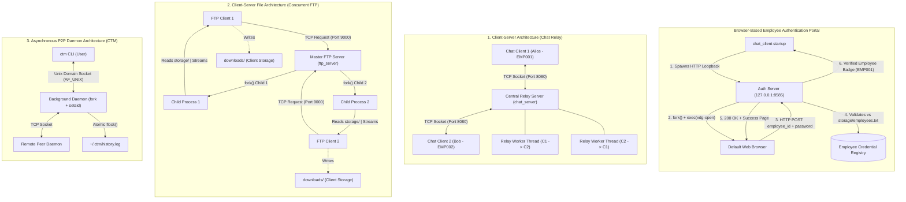

# Operating Systems Networking Suite: Chat Messenger, Concurrent FTP & CTM CLI

A modular, high-performance Linux system programming project implemented in C. Developed specifically for an **Operating Systems** curriculum, this codebase demonstrates core operating systems principles including **Client-Server Architecture**, **Browser-Based Employee Authentication (Single Sign-On)**, **POSIX Multithreading (`pthreads`)**, **Multiprocessing Concurrency (`fork`)**, **Inter-Process Communication (`AF_UNIX` sockets)**, **Kernel Advisory File Locking (`flock`)**, and **Background Daemonization**.

---

## Table of Contents

- [Architectural Overview](#architectural-overview)
  - [1. Client-Server Chat Relay Server with Browser Authentication](#1-client-server-chat-relay-server-with-browser-authentication)
  - [2. Concurrent Multi-Process FTP Server](#2-concurrent-multi-process-ftp-server)
  - [3. Asynchronous P2P Daemon Suite (CTM)](#3-asynchronous-p2p-daemon-suite-ctm)
- [Browser-Based Employee Authentication Portal](#browser-based-employee-authentication-portal)
- [File Storage Architecture Guide](#file-storage-architecture-guide)
- [Operating Systems Concepts Implemented](#operating-systems-concepts-implemented)
- [Project Directory Structure](#project-directory-structure)
- [Build Instructions](#build-instructions)
- [Execution & Usage Guide](#execution--usage-guide)
  - [1. Client-Server Chat Relay with Browser Login](#1-running-the-client-server-chat-relay)
  - [2. Concurrent FTP File Transfer](#2-running-the-concurrent-ftp-system)
  - [3. CTM (Git-Style Daemon Messenger)](#3-running-the-ctm-asynchronous-suite)
- [Protocol Specifications](#protocol-specifications)
- [Documentation & Reports](#documentation--reports)

---

## Architectural Overview

This project includes three complementary networking subsystems, contrasting traditional **Client-Server coordination** with **Concurrent multi-process file distribution** and **Asynchronous daemonized peer-to-peer communication**:



---

### 1. Client-Server Chat Relay Server with Browser Authentication
*Implemented in: `src/server/` (`relay.c`, `server_main.c`), `src/client/` (`chat_client.c`, `client_main.c`), and `src/common/` (`auth.c`)*

The Chat Messenger implements classic **Client-Server Architecture** with strict corporate security:
- **Mandatory Browser Authentication Gate**: With each login session, `chat_client` initiates a local HTTP loopback server and auto-redirects the user's default browser to a login portal. The employee must confirm their `employee_id` and corporate `password`. Non-employees are denied access.
- **Central Coordinator (`chat_server`)**: A centralized daemon socket binds and listens on port 8080. It manages client registration and connection handshakes.
- **Bi-directional Relaying**: Rather than requiring direct network connectivity between clients (which fails behind NATs and firewalls), the server bridges the two client sockets.
- **POSIX Multithreading**: The server provisions worker threads via `pthread_create()` to asynchronously forward messages between `Client 1` and `Client 2` with zero head-of-line blocking.
- **Poll-Driven Handshakes**: Uses non-blocking multiplexed I/O (`poll()`) to detect client drops before the peer even joins.

---

### 2. Concurrent Multi-Process FTP Server
*Implemented in: `src/ftp/` (`ftp_server.c`, `ftp_server_main.c`, `ftp_client.c`, `ftp_client_main.c`)*

The File Transfer System implements a **process-per-client concurrency model**:
- **Master Listener Process**: Runs an accept loop on port 9000.
- **Process Spawning via `fork()`**: Upon each incoming connection, the master server forks a dedicated child process. The child immediately inherits the client socket descriptor, closes the listening socket, streams the requested file, and terminates cleanly (`_exit(0)`).
- **Process Isolation**: Memory spaces are completely isolated by the OS virtual memory management system; a crash or slowdown in one client worker never affects other active transfers.
- **Zombie Prevention**: The master process registers `signal(SIGCHLD, SIG_IGN)` to instruct the Linux kernel to immediately reap child processes upon termination, eliminating `<defunct>` zombie processes.

---

### 3. Asynchronous P2P Daemon Suite (CTM)
*Implemented in: `src/ctm/` (`ctm_main.c`, `ctm_daemon.c`, `ctm_ipc.c`, `ctm_storage.c`)*

CTM provides a Git-style CLI (`ctm text`, `ctm updates`, `ctm log`, `ctm send-file`, `ctm fetch`, `ctm login`) powered by:
- **Zero-Configuration Daemonization**: Auto-spawns into the background using double-`fork()` and `setsid()`.
- **Local IPC**: The CLI talks to the local background daemon across high-speed Unix Domain Sockets (`AF_UNIX`).
- **Kernel Advisory Locking (`flock`)**: Atomically writes conversation logs using `flock(LOCK_EX)`, preventing race conditions across concurrent commands.

---

## Browser-Based Employee Authentication Portal

To ensure enterprise-grade security and prevent unauthorized access, **every chat login session is gated behind browser-based identity confirmation**:

1. **How It Works**:
   - When `./bin/chat_client` is launched, it starts a lightweight HTTP loopback daemon on `127.0.0.1:8585` (or an ephemeral port).
   - The OS process manager spawns the default web browser via `fork()` and `execlp("xdg-open", ...)` to open `http://127.0.0.1:8585/login`.
   - The employee enters their **Employee ID** and **Password** (or clicks a test account chip).
   - The credentials are validated against the corporate employee registry ([`storage/employees.txt`](file:///home/rey_/Chat_Messenger/storage/employees.txt)).
   - **Access Granted**: The browser renders a green success verification card, and the client terminal proceeds into the chat session with their verified employee badge attached (e.g., `Alice (EMP001)`).
   - **Access Denied**: Non-employees or invalid credentials trigger an alert. If authentication fails, the chat client terminates immediately and refuses access to the relay server.
   - **Headless Fallback**: In environments without a GUI/display, the terminal displays the clickable URL and provides an interactive terminal credential prompt.

### Registered Test Employee Accounts

| Employee ID | Corporate Password | Full Name | Department | Role |
|---|---|---|---|---|
| `EMP001` | `alice123` | Alice | Engineering | Systems Developer |
| `EMP002` | `bob123` | Bob | Security Operations | Security Lead |
| `EMP003` | `charlie123` | Charlie | Systems Architecture | OS Architect |
| `EMP101` | `osproject2026` | Rey | Kernel Development | Systems Administrator |
| `EMP102` | `adminpass` | Administrator | IT Infrastructure | Enterprise Root |

*(New employees can be added dynamically to [`storage/employees.txt`](file:///home/rey_/Chat_Messenger/storage/employees.txt) without recompiling).*

---

## File Storage Architecture Guide

To ensure complete conceptual clarity, file storage in this repository is strictly decoupled between the **Server** and the **Client**:

```
Chat_Messenger/
│
├── storage/                 ◄── [SERVER STORAGE REPOSITORY]
│   ├── README.md            # Documentation on server-side hosting & file isolation
│   ├── employees.txt        # Enterprise employee credential registry (auth database)
│   ├── demo.txt             # Text/code sample file (ASCII stream test)
│   └── image.jpg            # Binary JPEG image sample (binary chunked stream test)
│
└── downloads/               ◄── [CLIENT DOWNLOAD DESTINATION]
    ├── .gitkeep             # Preserves empty downloads directory in Git
    ├── README.md            # Guide on client reception and diff verification
    └── (received files)     # Downloaded client files land here (ignored by git)
```

### 1. Server Storage (`storage/`)
- **Role**: Authoritative server-side repository hosted by `bin/ftp_server`.
- **Credential Store**: Contains [`storage/employees.txt`](file:///home/rey_/Chat_Messenger/storage/employees.txt) used to verify employee identities.
- **How to Host Files**: Simply copy or move any file into `storage/` (e.g. `cp my_presentation.pdf storage/`). The FTP server serves it immediately without restarts.
- **Security & Path Traversal**: In accordance with OS security principles, the server validates every requested filename. Requests containing `..` or leading `/` are rejected with `ERR` to prevent directory traversal.

### 2. Client Storage (`downloads/`)
- **Role**: Local storage space where `bin/ftp_client` writes retrieved data streams.
- **Decoupling**: By saving incoming files to `downloads/` instead of `storage/`, the server's authoritative assets remain clean and untainted.
- **Integrity Verification**: Transferred files can be verified against the original via:
  ```bash
  diff storage/demo.txt downloads/demo.txt
  # No output indicates a bit-for-bit identical transfer!
  ```

### 3. CTM Persistent Storage (`~/.ctm/<username>/`)
For the asynchronous CTM tool, persistent user data is saved under the user's home directory:
- `~/.ctm/<user>/session.auth`: Authenticated employee session badge.
- `~/.ctm/<user>/history.log`: Chat history, protected by `flock(LOCK_EX)` for atomic appends.
- `~/.ctm/<user>/outbox.log`: Stored messages awaiting delivery.
- `~/.ctm/<user>/config`: Peer IP addresses, ports, and identities.
- `~/.ctm/<user>/downloads/`: Files received via peer-to-peer file transfer (`ctm send-file`).

---

## Operating Systems Concepts Implemented

| OS Concept | System Calls / Primitives Used | Code Location | Description |
|---|---|---|---|
| **Client-Server Model** | `socket()`, `bind()`, `listen()`, `accept()`, `connect()` | `src/server/`, `src/client/`, `src/ftp/` | Centralized relay coordinator and concurrent FTP file server architectures. |
| **Browser Authentication** | `socket()`, `getsockname()`, `fork()`, `execvp()`, HTTP 1.1 | `src/common/auth.c` | Ephemeral HTTP loopback server and process-spawned browser for employee single sign-on. |
| **Multithreading** | `pthread_create()`, `pthread_join()`, `pthread_t` | `src/client/chat_client.c`, `src/server/relay.c` | Independent asynchronous send/receive execution threads to avoid I/O blocking. |
| **Process Concurrency** | `fork()`, `_exit()`, `pid_t` | `src/ftp/ftp_server_main.c`, `src/ctm/ctm_daemon.c` | Independent child worker processes spawned per connection for concurrent file streaming. |
| **Zombie Prevention** | `signal(SIGCHLD, SIG_IGN)` | `src/ftp/ftp_server_main.c` | Kernel-level automatic process table reaping to eliminate `<defunct>` processes. |
| **Inter-Process Comm (IPC)** | `socket(AF_UNIX, SOCK_STREAM)`, `struct sockaddr_un` | `src/ctm/ctm_ipc.c` | Low-latency local communication between CLI frontend and background daemon. |
| **File Locking** | `flock()`, `LOCK_EX`, `LOCK_SH`, `LOCK_UN` | `src/ctm/ctm_storage.c` | Kernel-level advisory locking ensuring atomicity during concurrent file operations. |
| **Daemonization** | `fork()`, `setsid()`, `freopen()`, `chdir()` | `src/ctm/ctm_daemon.c` | Detaches processes from controlling terminal sessions into true background services. |
| **I/O Multiplexing** | `poll()`, `struct pollfd`, `POLLIN`, `POLLHUP` | `src/server/relay.c`, `src/common/auth.c` | Non-blocking event-driven monitoring of socket descriptors and timeout control. |
| **Async-Signal Safety** | `signal(SIGINT)`, `write(2)`, `_exit(2)` | `src/server/server_main.c`, `src/ftp/ftp_server_main.c` | Avoids deadlocks by restricting signal handlers exclusively to async-safe primitives. |
| **Socket Options & Policies** | `setsockopt()`, `SO_REUSEADDR`, `SO_REUSEPORT` | `src/common/network.c` | Eliminates TCP `TIME_WAIT` rebind delays and enables clean server restarts. |
| **SIGPIPE Suppression** | `MSG_NOSIGNAL`, `signal(SIGPIPE, SIG_IGN)` | `src/common/protocol.c` | Prevents process termination when writing to abruptly closed network sockets. |
| **File System Security** | `open(O_RDONLY)`, `stat()`, `S_ISREG` | `src/ftp/ftp_server.c` | Sanitizes input paths against directory traversal (`..`) and checks regular file flags. |
| **Chunked Streaming** | `read(2)`, `write(2)`, `send()`, `recv()` | `src/ftp/ftp_server.c`, `src/ftp/ftp_client.c` | High-throughput 1024-byte chunked TCP streaming with complete EOF propagation. |
| **Safe Framing** | `proto_read_line()`, `snprintf()` | `src/common/protocol.c` | Eliminates buffer overflow risks via strictly bounded character consumption. |

---

## Project Directory Structure

```
Chat_Messenger/
├── Makefile                 # Modular build automation with clean separation of targets
├── README.md                # Comprehensive documentation and OS concept mapping
├── .gitignore               # Excludes binaries, build objects, and temporary downloads
│
├── docs/                    # Academic Documentation
│   ├── Chat_Messenger_Project_Report.docx  # 15-page OS Academic Technical Report
│   └── Documentation.pdf                  # Original architecture specifications
│
├── include/                 # Header Declarations & Interfaces
│   ├── auth.h               # Employee authentication, sessions, and HTTP portal prototypes
│   ├── common.h             # Shared constants, ANSI colors, loggers, buffer bounds
│   ├── chat_server.h        # Relay server function declarations and state structs
│   ├── chat_client.h        # Chat client worker thread signatures and auth context
│   ├── ftp.h                # Concurrent FTP server/client interfaces & wire protocol
│   ├── ctm.h                # CTM daemon, IPC, and persistent storage prototypes
│   ├── network.h            # Socket creation, bind, reuseaddr, and port cleanup
│   └── protocol.h           # Bounded line-reading and byte transmission wrappers
│
├── src/                     # C Source Implementations
│   ├── common/              # Shared Subsystem Utilities
│   │   ├── auth.c           # HTTP loopback server, HTML5 login portal, credential verification
│   │   ├── network.c        # TCP socket wrappers, port reuse options, cleanup
│   │   └── protocol.c       # Safe framed I/O (proto_read_line, proto_send_all)
│   ├── server/              # Centralized Relay Server Subsystem
│   │   ├── relay.c          # Bidirectional message forwarding & client sync
│   │   └── server_main.c    # Chat server CLI entry point & SIGINT handling
│   ├── client/              # Chat Client Subsystem
│   │   ├── chat_client.c    # Multithreaded sender and receiver worker threads
│   │   └── client_main.c    # Chat client entry point with browser authentication gate
│   ├── ftp/                 # Concurrent Multi-Process FTP Subsystem
│   │   ├── ftp_server.c     # Path sanitization, header transmission, chunk streaming
│   │   ├── ftp_server_main.c# Master server daemon, fork() child spawning, zombie reaping
│   │   ├── ftp_client.c     # Header verification and chunk-to-disk receiver
│   │   └── ftp_client_main.c# FTP client CLI entry point (defaults to downloads/)
│   └── ctm/                 # Asynchronous Daemon & P2P CLI Subsystem
│       ├── ctm_main.c       # Git-style CLI commands (text, updates, log, send-file, login)
│       ├── ctm_daemon.c     # Background service worker (fork + setsid, socket loop)
│       ├── ctm_ipc.c        # AF_UNIX local IPC client/server implementation
│       └── ctm_storage.c    # Kernel flock() file operations & config loading
│
├── storage/                 # Server-Side File Storage Repository
│   ├── README.md            # Storage documentation and hosting instructions
│   ├── employees.txt        # Corporate employee credentials database
│   ├── demo.txt             # Sample ASCII source file for transfer validation
│   └── image.jpg            # Sample binary JPEG image for transfer validation
│
└── downloads/               # Client-Side Download Directory
    ├── .gitkeep             # Git directory placeholder
    └── README.md            # Client download instructions and diff validation guide
```

---

## Build Instructions

### Prerequisites
- **Operating System**: Linux (Ubuntu, Debian, Fedora, Arch, CentOS, etc.)
- **Compiler**: GCC (`gcc`) with C99 or C11 support
- **Build Tool**: GNU Make (`make`)
- **System Libraries**: POSIX Threads (`-pthread`)

### Compilation Targets

```bash
# Build all binaries into bin/
make

# Build individual subsystems:
make chat        # Builds bin/chat_server and bin/chat_client (Client-Server Relay)
make ftp         # Builds bin/ftp_server and bin/ftp_client (Concurrent FTP)
make ctm         # Builds bin/ctm (Git-style asynchronous CLI tool)

# Install ctm globally to ~/.local/bin/
make install

# Clean all compiled object files and binaries
make clean

# Display available make targets
make help
```

---

## Execution & Usage Guide

### 1. Running the Client-Server Chat Relay

The Relay Server operates as the central coordinator, connecting two remote clients for bidirectional conversation over TCP with mandatory employee authentication.

#### Step 1: Start the Relay Server
```bash
./bin/chat_server 8080
```
*The server initializes on port 8080 and waits for clients to connect.*

#### Step 2: Connect Client 1 (Alice)
In a second terminal:
```bash
./bin/chat_client 127.0.0.1 8080 Alice
```
1. The terminal displays the authentication prompt and opens the browser portal:
   `--> http://127.0.0.1:8585/login`
2. In the browser, confirm Employee ID: `EMP001` and Password: `alice123`.
3. The browser confirms authentication and closes.
4. Alice enters the chat session verified as `Alice (EMP001)`:
   *`Connected as Client 1. Waiting for peer to join...`*

#### Step 3: Connect Client 2 (Bob)
In a third terminal:
```bash
./bin/chat_client 127.0.0.1 8080 Bob
```
1. Browser opens for Bob's session.
2. Enter Employee ID: `EMP002` and Password: `bob123`.
3. Authentication succeeds: Bob is verified as `Bob (EMP002)`.
4. *Both clients are notified: `Peer joined! Chat starting!`*

#### Interactive Chatting
- Type any message and press **ENTER**.
- Messages are formatted with verified employee identities: `[Alice (EMP001)]: Hello Bob!`.
- Type `/exit` or `/quit` to gracefully disconnect.

---

### 2. Running the Concurrent FTP System

The FTP system demonstrates multiprocessing concurrency with `fork()` and chunked streaming from `storage/` to `downloads/`.

#### Step 1: Start the Concurrent FTP Server
```bash
./bin/ftp_server 9000
```
*The server starts listening on port 9000 and serves all files inside `storage/`.*

#### Step 2: Download a Text File (Client)
In a separate terminal:
```bash
./bin/ftp_client 127.0.0.1 9000 demo.txt
```
*The client requests `demo.txt`. The server forks a child process to stream the file. The client saves it into `downloads/demo.txt`.*

#### Step 3: Download a Binary Image File (Client)
```bash
./bin/ftp_client 127.0.0.1 9000 image.jpg
```
*The binary image is chunk-streamed and written to `downloads/image.jpg`.*

#### Step 4: Verify Transfer Integrity
```bash
diff storage/demo.txt downloads/demo.txt
diff storage/image.jpg downloads/image.jpg
```
*Zero diff output confirms 100% byte-for-byte transmission integrity.*

---

### 3. Running the CTM Asynchronous Suite

CTM provides asynchronous terminal messaging without keeping terminal windows open. The background daemon auto-starts and manages message persistence with `flock()`.

#### 1. Employee Login via Browser Portal
```bash
ctm login
# Spawns browser login portal, authenticates employee credentials,
# and stores active session in ~/.ctm/Alice/session.auth
```

#### 2. Configuration
```bash
# Configure Alice:
ctm config --name Alice --peer Bob --peer-ip 127.0.0.1

# Configure Bob (or test on single machine with --user flag):
ctm --user Bob config --name Bob --peer Alice --peer-ip 127.0.0.1
```

#### 3. Core Workflow Commands
```bash
# Send an asynchronous message:
ctm text Bob -m "Operating Systems project is ready!"

# Check for unread message notifications:
ctm --user Bob updates

# View conversation history (marks unread messages as read):
ctm --user Bob log -n 10

# Send a file via background daemon:
ctm send-file Bob storage/demo.txt

# List received files in downloads directory:
ctm --user Bob fetch
```

---

## Protocol Specifications

### 1. HTTP Employee Authentication Protocol
- **Transport**: TCP Stream (`SOCK_STREAM`) on loopback interface (`127.0.0.1:<port>`).
- **Endpoints**:
  - `GET /login`: Returns HTML5/CSS authentication page with embedded quick-fill chips.
  - `POST /login`: Validates `employee_id` and `password` payload against credential store.
- **Response**: HTTP 200 with green verification badge on success; HTTP 200 with error notification and re-try prompt on failure.

### 2. Chat Relay Wire Protocol
- **Transport**: TCP Stream (`SOCK_STREAM`)
- **Framing**: UTF-8 line-delimited text terminated by newline (`\n`).
- **Payload Format**: `[Sender (Employee_ID)]: [Message]\n`
- **Control Sequences**: `/exit\n`, `/quit\n`

### 3. Concurrent FTP Wire Protocol
1. **Client Request**: Transmits requested filename followed by newline: `demo.txt\n`
2. **Server Handshake**:
   - On success: `OK <file_size_in_bytes>\n` (e.g. `OK 4470\n`)
   - On error: `ERR\n` (e.g. file not found, permission denied, or path traversal attempt)
3. **Data Streaming Phase**: The server streams exactly `<file_size_in_bytes>` binary bytes in 1024-byte chunks directly to the client socket, followed by socket closure.

### 4. CTM Local IPC Protocol
- **Transport**: Unix Domain Stream Socket (`AF_UNIX`) at `/tmp/ctm_<username>.sock`
- **Commands**: `SEND <peer> <msg>`, `STATUS`, `LOG <lines>`, `SENDFILE <peer> <path>`
- **Response**: Immediate structured status code followed by data payload.

---

## Documentation & Reports

Comprehensive academic documentation is located in the `docs/` directory:
- [`docs/Chat_Messenger_Project_Report.docx`](file:///home/rey_/Chat_Messenger/docs/Chat_Messenger_Project_Report.docx): Complete 15-page Operating Systems project technical report detailing thread synchronization, fork concurrency, socket architecture, and benchmarking.
- [`docs/Documentation.pdf`](file:///home/rey_/Chat_Messenger/docs/Documentation.pdf): Original architecture specification and project design document.
- [`storage/README.md`](file:///home/rey_/Chat_Messenger/storage/README.md): Detailed guide on server-side file repository management and security.
- [`downloads/README.md`](file:///home/rey_/Chat_Messenger/downloads/README.md): Detailed guide on client download destination and diff verification.

---

## Authors & Academic Credits
Implemented in C for Linux Systems Programming & Operating Systems Coursework.
