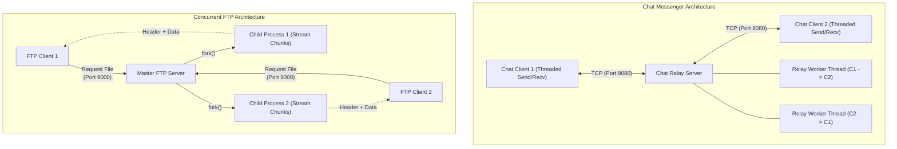

# Chat Messenger & Concurrent FTP System

A high-performance, modular Linux system programming suite implemented in C. The repository features two complementary network subsystems:
1. **Chat Messenger**: A full-duplex, peer-to-peer relay messaging service utilizing POSIX threads (`pthreads`) for non-blocking asynchronous transmission.
2. **Concurrent FTP System**: A multi-client file transfer service employing process-based concurrency (`fork`) with chunked TCP streaming and protocol header verification.

---

## Architecture Overview



---

## Project Structure

```
Chat_Messenger/
├── .gitignore               # Excludes build artifacts and binaries
├── Makefile                 # Modular build automation
├── README.md                # Project documentation and user guide
├── docs/
│   └── Documentation.pdf    # Original architecture specifications
├── include/
│   ├── chat_client.h        # Client worker threads and session context
│   ├── chat_server.h        # Server relay engine and session management
│   ├── common.h             # Shared constants, macros, headers, and loggers
│   ├── ftp.h                # FTP file transfer protocol and interfaces
│   ├── network.h            # Socket connection, bind, listen, and port cleanup
│   └── protocol.h           # Safe I/O, line parsing, and buffer transmission
├── src/
│   ├── common/
│   │   ├── network.c        # TCP socket creation, reuseaddr, connection helpers
│   │   └── protocol.c       # proto_read_line, proto_send_all, proto_recv_all
│   ├── server/
│   │   ├── relay.c          # Bidirectional peer forwarding and disconnect sync
│   │   └── server_main.c    # Chat server CLI entry point and signal handling
│   ├── client/
│   │   ├── chat_client.c    # Multithreaded send and receive workers
│   │   └── client_main.c    # Chat client entry point and user config
│   └── ftp/
│       ├── ftp_client.c     # Header verification and file chunk receiver
│       ├── ftp_client_main.c# FTP client CLI entry point
│       ├── ftp_server.c     # File validation and chunked stream sender
│       └── ftp_server_main.c# Concurrent fork-based daemon and child reaper
└── storage/
    ├── demo.txt             # Sample text asset for file transfer testing
    └── image.jpg            # Sample binary image asset for transfer testing
```

---

## Key Features & Design Principles

- **Separation of Concerns**: Networking logic, wire protocol, application workers, and entry points are cleanly split into modular source and header files.
- **Multithreading with POSIX Threads**: The chat client and relay server run dedicated sender and receiver threads, eliminating blocking I/O bottlenecks.
- **Process Concurrency with `fork()`**: The FTP server isolates each client connection inside an independent child process, guaranteeing parallel transfer capacity without thread contention.
- **Zombie Process Prevention**: Child processes are automatically reaped using `signal(SIGCHLD, SIG_IGN)` to prevent lingering `<defunct>` states.
- **Robust Error & Signal Safety**:
  - `SIGINT` (Ctrl+C) is handled safely using async-signal-safe primitives (`write(2)` and `_exit(2)`).
  - Port conflicts are mitigated using `SO_REUSEADDR` / `SO_REUSEPORT` alongside port cleanup helpers.
  - Sockets and file descriptors are systematically cleaned up on disconnects to eliminate resource leaks.
- **Buffer Safety**: Eliminates buffer overflows by utilizing bounded formatting (`snprintf`) and custom bounded line-reading (`proto_read_line`).

---

## Build Instructions

### Prerequisites
- Linux OS (Ubuntu 20.04+, Debian, Arch, Fedora, etc.)
- GCC (`gcc`)
- Make (`make`)
- POSIX Threads Library (`libpthread`)

### Compilation Commands

| Command | Action |
|---|---|
| `make` or `make all` | Builds all 4 binaries into `bin/` |
| `make chat` | Builds `bin/chat_server` and `bin/chat_client` |
| `make ftp` | Builds `bin/ftp_server` and `bin/ftp_client` |
| `make clean` | Removes all compiled objects (`build/`) and binaries (`bin/`) |
| `make help` | Displays build targets and usage options |

---

## Usage Guide

### 1. Chat Messenger

The chat service pairs two clients via the relay server for bidirectional live conversation.

#### Terminal 1 — Start Server
```bash
./bin/chat_server 8080
```
*Note: If no port is passed, you will be prompted interactively (default: `8080`).*

#### Terminal 2 — Connect First Client (Alice)
```bash
./bin/chat_client 127.0.0.1 8080 Alice
```
*Alice receives a notice: `Connected as Client 1. Waiting for peer to join...`*

#### Terminal 3 — Connect Second Client (Bob)
```bash
./bin/chat_client 127.0.0.1 8080 Bob
```
*Both clients are notified: `Peer joined! Chat starting!`*

#### Interactive Chat
- Simply type your message and press **ENTER**.
- Messages appear in the format: `[Username]: [Message]`.
- Type `/exit` or `/quit` to gracefully leave the conversation.

---

### 2. Concurrent FTP File Transfer

The FTP service serves files located inside the `storage/` directory over TCP.

#### Terminal 1 — Start FTP Server
```bash
./bin/ftp_server 9000
```
*The FTP server begins listening on port 9000 and prepares to serve files from `storage/`.*

#### Terminal 2 — Download File via FTP Client
```bash
# Syntax: ./bin/ftp_client <server_ip> <port> <remote_filename> <local_filename>
./bin/ftp_client 127.0.0.1 9000 demo.txt storage/downloaded_demo.txt
```

#### Transfer Verification
```bash
diff storage/demo.txt storage/downloaded_demo.txt
# No differences means the file was transferred with 100% integrity
```

---

## Protocol Specifications

### Chat Protocol
- **Transport**: TCP Stream (`SOCK_STREAM`)
- **Framing**: UTF-8 line-delimited text (`\n`)
- **Payload**: `<Username>: <Message>\n`

### FTP Wire Protocol
1. **Client Request**: Client transmits target filename followed by `\n` (e.g. `image.jpg\n`).
2. **Server Handshake**:
   - Success: `OK <file_size_in_bytes>\n` (e.g. `OK 20141\n`)
   - Failure: `ERR\n` (e.g. file not found, permission denied, path traversal blocked)
3. **Data Phase**: The server streams exactly `<file_size_in_bytes>` binary bytes in 1024-byte chunks directly to the client socket, followed by socket closure.

---

## License & Credits
Developed as part of the Linux System Programming & Socket Networking projects.
